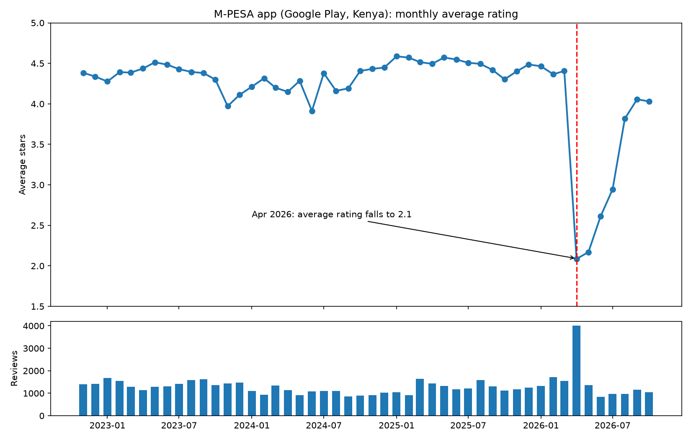
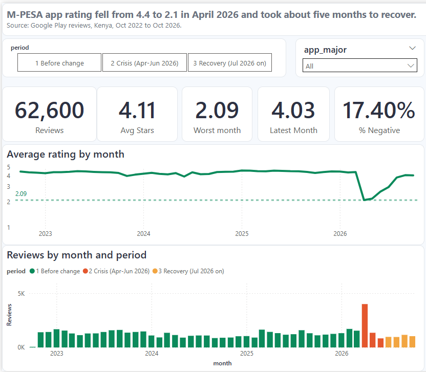
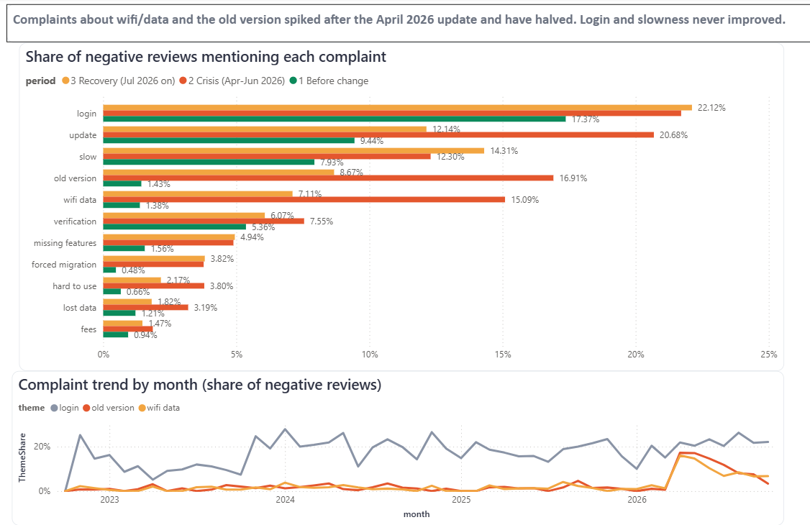
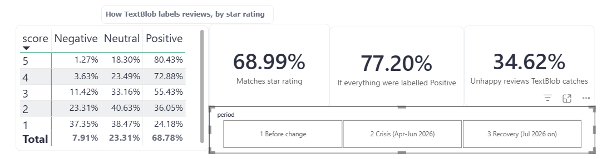

# Kenya Brand Pulse

**What happened to M-PESA's reputation when Safaricom merged My Safaricom into the M-PESA app, and what did users complain about?**

A brand-reputation tracker built on 62,600 public Google Play reviews of the M-PESA app in Kenya (October 2022 to October 2026). It covers scraping, cleaning, sentiment scoring, complaint-theme analysis and a three-page Power BI dashboard a non-technical marketer can filter without writing code.

> Independent portfolio project. Not affiliated with Safaricom. Uses public review data only.

---

## Headline findings

**1. The rating collapsed in April 2026 and took about five months to recover.**
The average rating held around 4.4 stars for three and a half years, then fell to **2.09 in April 2026**. Review volume tripled that month (about 4,000 reviews against a usual 1,000 to 1,700). By September 2026 the rating was back to about 4.0, still below the old level.



**2. Two complaints exploded after the update, then roughly halved.**
Share of 1-2 star reviews mentioning each theme:

| Complaint | Before the change | Crisis (Apr-Jun 2026) | Recovery (Jul 2026 on) |
|---|---|---|---|
| Needs wifi / mobile data to log in | 1.4% | **15.1%** | 7.1% |
| Wants the old version back | 1.4% | **16.9%** | 8.7% |
| Mentions the update | 9.4% | **20.7%** | 12.1% |
| Login problems | 17.4% | 21.7% | **22.1%** |
| Slow / laggy | 7.9% | 12.3% | **14.3%** |

**3. Login problems and slowness never improved.**
Both are as high or higher in the recovery period than during the crisis. Login was already the biggest complaint before the update, so the update made things worse for some users but did not create that problem.

**4. TextBlob is a weak baseline for this data.**
Against star ratings (1-2 stars read as negative, 3 as neutral, 4-5 as positive):

| Measure | Result |
|---|---|
| Correlation between TextBlob polarity and stars | 0.49 |
| TextBlob label matches the star band | 69.0% |
| Matches if every review were simply labelled Positive | 77.2% |
| Unhappy (1-2 star) reviews that TextBlob labels negative | 34.6% |

Only 37% of 1-star reviews are labelled negative, and about 18% of 5-star reviews are labelled neutral (short praise such as "one in a million" or emoji-only reviews). Kenyan reviews also mix English, Swahili and Sheng, which an English-only lexicon cannot read. TextBlob does track the *monthly trend* (average polarity fell to about 0 in April 2026), but it is unreliable on individual reviews. Replacing it is the next phase.

---

## Dashboard

| Brand health | Crisis drivers | TextBlob check |
|---|---|---|
|  |  |  |

The Power BI file is in [`dashboards/kenya_brand_pulse.pbix`](dashboards/kenya_brand_pulse.pbix). It contains scores, dates, app versions and theme flags only. Review text is deliberately excluded.

---

## How it works

```
Google Play reviews --> scraper --> CSV --> sentiment + theme flags --> Power BI
 (public, Kenya)     (pagination,         (TextBlob, keyword        (3-page dashboard,
                      polite delays)        themes, periods)          slicers by period/version)
```

| Step | Script |
|---|---|
| Scrape reviews with pagination | `src/scrapers/playstore.py` |
| Check where TextBlob fails | `src/analysis/diagnose.py` |
| Monthly timeline and app versions | `src/analysis/timeline.py`, `src/analysis/plot_timeline.py` |
| Compare crisis vs baseline complaint themes | `src/analysis/crisis_themes.py` |
| Build Power BI-ready tables | `src/export_powerbi.py` |

## Run it yourself

```powershell
git clone https://github.com/tonyspetea/kenya-brand-pulse.git
cd kenya-brand-pulse
python -m venv .venv
.venv\Scripts\activate
python -m pip install -r requirements.txt
python -m textblob.download_corpora

python src\scrapers\playstore.py      # scrape (takes a few minutes)
python src\analysis\timeline.py       # monthly trend
python src\analysis\crisis_themes.py  # complaint themes
python src\export_powerbi.py          # tables for Power BI
```

Raw data is written to `data/`, which is git-ignored. Re-running the scraper and export, then clicking **Refresh** in Power BI, updates the dashboard.

---

## Limitations

- **Keyword themes are approximate.** Themes are matched with word patterns, so a review can match several, and some matches are wrong. They are leads to investigate, not exact counts.
- **Theme figures are shares of negative reviews, not counts.** A steady share can still mean fewer people complaining, since fewer negative reviews are left after the crisis.
- **Star ratings are a noisy label.** Some 1-star reviews say the app is good, so "TextBlob disagrees with the stars" overstates the model's errors. A hand-labelled sample will give firmer accuracy numbers.
- **Play Store reviews are not everyone.** They over-represent Android users who chose to leave a review.
- **The first month (October 2022) is partial** and is left out of trend comparisons.
- **Reviews were pulled in English for Kenya,** so reviews written in other languages may be under-represented.

## Ethics and data handling

Only public reviews are used. No usernames are stored, review text is excluded from the published dashboard, and keys and raw data stay out of the repository. Scraping is rate-limited with pauses between requests.

## Roadmap

- [ ] Add more brands (other Safaricom apps, banks) for a share-of-voice comparison
- [ ] Hand-label about 300 reviews and benchmark TextBlob, VADER and a multilingual transformer model (XLM-RoBERTa) for English, Swahili and Sheng
- [ ] Train an H2O AutoML classifier on the labelled sample
- [ ] Store data in a database with deduplication, and run the pipeline on a nightly schedule
- [ ] Add further public sources (Reddit, YouTube comments, news pages) to build web-scraping range

---

**Author:** Antony Mutwiri Kabicii | [github.com/tonyspetea](https://github.com/tonyspetea)
